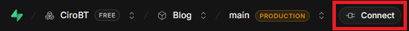
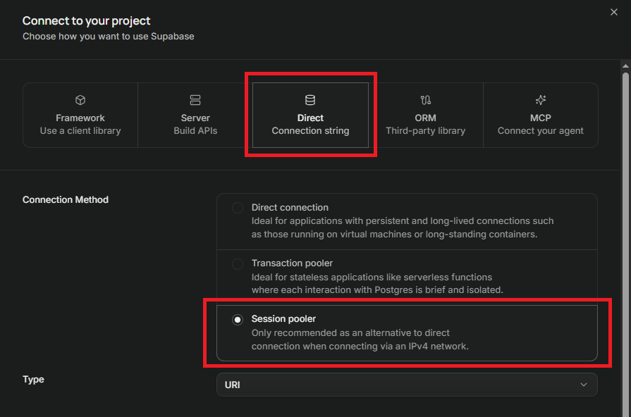

# BLOG

<details>
<summary style="font-size:20px;font-weight:500">DEVELOPMENT</summary>

### .env

#### For development, you won't need the root .env file. Rename your .env.local.example **.env.local** and set up your environment. For Java Spring Boot I'd recommend IntelliJ community (free). Edit your application configuration and set/import your .env variables.

### Keycloak

#### Realm

##### Left pannel > Manage realms > Create Realm. Name it whatever you want. Ex.: blog-realm. Everything from now on must be done inside your realm. Do not forget to navigate to your realm everytime you log in to admin panel. In case you accidently delete admin user, create a new one with code below:

```bash
./kc.sh bootstrap-admin user

./kc.bat bootstrap-admin user
```

#### Realm Settings

##### TODO

#### Clients

##### TODO

#### Real Roles

##### TODO

#### Next.js Client

##### Now, go to: Left pannel > Clients > Create Client

- Client ID: name it whatever you want. Ex.: blog-next
- Root URL: set http://localhost:3000
- Redirect URIs: set http://localhost:3000/\*
- Web origins: set http://localhost:3000
- Admin URL: http://localhost:3000

##### Client Secret: inside Credentials tab. Copy it to your project

##### Service Account Roles:

- Open the tab Assign role and filter by manage-users: mark it as true

#### Spring Client

- Client ID: name it whatever you want. Ex.: blog-api
- Client Authentication: true
- Service Account Roles: true. Then, navigate to Service Account Roles and assign role manage-users

##### Client Secret: inside Credentials tab. Copy it to your project

##### Spring Boot might need to accept multiple audiences in order to validate the JWT, otherwise your signIn might works for Keycloak, and neglected by Spring Boot. In this project, at least two must be included. The one that has been created inside Spring Boot, and that which comes from the client as well. Follow as ahead:

- Left admin pannel > Client Scopes > Create client scope. Name it. Ex.: blog-api-audience. Go to: Mappers > Configure a new mapper > Audience. Name it. Ex.: blog-api-audience-mapper. Add frontend client id, that one inside your KEYCLOAK_BLOG_API_CLIENT_ID. Save. Now, go to Clients again, and navigate to web client this time. Client scopes > Add client and choose the blog-api-audience we had just created. Set it as default.

```bash
./kc.sh start-dev --http-port=8085 --spi-theme--static-max-age=-1 --spi-theme--cache-themes=false --spi-theme--cache-templates=false

./kc.bat start-dev --http-port=8085 --spi-theme--static-max-age=-1 --spi-theme--cache-themes=false --spi-theme--cache-templates=false
```

### Next.js

```bash
cd .\web

pnpm i

pnpm dev
```

### Database

#### There is a couple of options. I believe the easiest one is Docker

```bash
docker-compose up -d --build
```

#### If you have no access to DOcker for whatever the reason, Supabase comes in very handy for development situation in my opinion. Supabase > authenticate > create a new project > dashboard > connect (button somewhere on top) > direct > session pooler.





```yml
datasource.url: jdbc:postgresql://${POSTGRES_HOST}:${POSTGRES_PORT}/${POSTGRES_DB}?prepareThreshold=0

POSTGRES_HOST=
POSTGRES_DB=postgres
POSTGRES_PORT=6543
POSTGRES_USER=
POSTGRES_PASSWORD=
```

</details>

<details>
<summary style="font-size:20px;font-weight:500">PRODUCTION</summary>

### .env

#### **Rename .env.example to `.env` and set up your environment.**

```bash
docker-compose up -d --build
```

</details>
