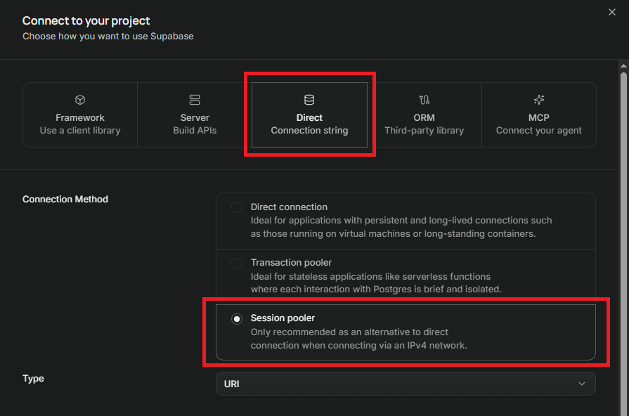

# BLOG

## DEVELOPMENT

### .env

- For development, you won't need the root .env file. Rename your .env.local.example **.env.local** and set up your environment. For Java Spring Boot I'd recommend IntelliJ community (free). Edit your application configuration and set/import your .env variables.

### Next.js

```bash
cd .\web

pnpm i

pnpm dev
```

### Keycloak

```sh
# Em .\keycloak\bin
.\kc.bat start-dev --http-port=8085
```

### Database

#### There is a couple of options. I believe the easiest one is Docker

```bash
docker-compose up -d --build
```

#### If you have no access to DOcker for whatever the reason, Supabase comes in very handy for development situation in my opinion. Supabase > authenticate > create a new project > dashboard > connect (button somewhere on top) > direct > session pooler.




```yml
datasource.url: jdbc:postgresql://${POSTGRES_HOST}:${POSTGRES_PORT}/${POSTGRES_DB}?prepareThreshold=0

POSTGRES_HOST=
POSTGRES_DB=postgres
POSTGRES_PORT=6543
POSTGRES_USER=
POSTGRES_PASSWORD=
```

---

## PRODUCTION

### Keycloak

Exporting Keycloak configuration from dev to production. Obs.: `--users skip` ignore test users.

```sh
.\kc.bat export --dir .\export --realm my-realm-name --users skip
```

- Para criar um volume `Docker`: TODO (duplicado)

```sh
docker run --rm -v keycloak_data:/data -v $(pwd)/keycloak/import:/out alpine cp /data/export/NOME_DO_SEU_REALM-realm.json /out/
```

```bash
docker-compose up -d --build
```

### Docker

- É preciso gerar o volume `Docker` do `Keycloak` para que ele seja lido em `build`. As configurações podem ser feitas durante desenvolvimento e quando tudo estiver pronto o volume precisa ser criado com o comando `CLI` interno do `Keycloak` para exportação, assim:

```sh
docker exec -it keycloak /opt/keycloak/bin/kc.sh export --dir /opt/keycloak/data/import --realm seu-nome-do-realm --users realm_file
```

- Variáveis
- Se você criou usuários de teste e não quer esses usuários sendo enviados juntos ao `JSON` geral, troque `--users realm_file` por `--users skip`
- Assim que o arquivo existir, é imprescindível que os `secrets`, `passwords`, `keys`, `clientIds` sejam substituídos por variáveis de ambiente e que os objetos RSA sejam excluídos. As variáveis de ambiente são escritas assim: `${O_NOME_DA_VARIAVEL}`, sem notação ponto com `.env`.

### Hostinger

- Criar uma VPS para testes. Neste tutorial eu uso Dokploy;
- Dar permissão ao script.

```sh
chmod +x setup-keycloak.sh
```

#### DNS

- Contratar um domínio;
- Em domínios -> DNS / Nameservers -> SSL: ative o SSL (leva alguns minutos);
- Configure os registros de DNS. Nesta parte, é melhor pedir ao agente. Basicamente, cada subdomínio precisa ter um registro do tipo `A` (aponta para o endereço IP). Por exemplo: `admin` significa que `www.admin.seu-dominio.com.br` será o apelido do seu Dokploy, para você não ter de entrar diretamente digitando o endereço IP (e também para ter o encrypt SSL/secure HTTPS). Para este projeto, será necessário repetir o processo para: `admin`, `blog` (prefixo de domínio blog que usei), `api`, `www`, `auth` e `keycloak` (este por precaução). Todos apontam para seu endereço IP.

### Dokploy

#### Projeto

- No painel `Dokploy`, em `settings` (menu esquerdo), procure por `Projects`. Essa parte é bem fácil e é autoexplanatória também. Conecte-se ao seu `Git`, defina suas `environments` e configure o `domains`.

#### Github

- Para fazer por Github, já logado ao painel Dokploy, em settings (menu esquerdo), procure `Git`. Use o provedor `Github` e configur ele. É autoexplanatório. Permita os projetos que você queira que o Dokploy tenha acesso para `CI/CD`.

#### Settings

- Aqui vem o SSL do `www.admin.seu-dominio.com.br`. No `Dokploy`, menu esquerdo, em `settings` -> `Web Server`: registre o domínio (`www.admin.seu-dominio.com.br`), coloque seu email, ative `HTTPS` e certifique com `Let's Encrypt`.
